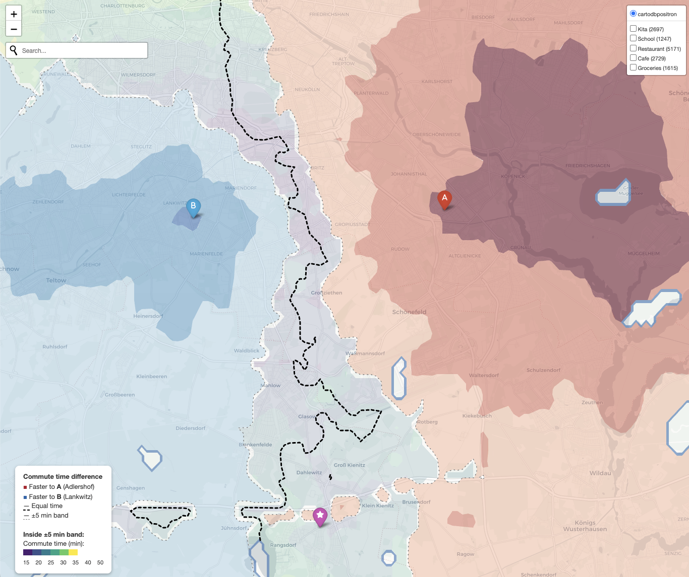

# Equal Commute Finder

Find neighborhoods where driving commute time to **two** workplaces is roughly
equal — useful when two people in a household work in different parts of a
city and need to pick somewhere to live.



## What it does

1. Samples a regular grid over a bounding box around the city
2. Asks [OpenRouteService](https://openrouteservice.org/) for driving time
   from every grid point to each workplace
3. Computes the scalar field `t_A − t_B` and extracts the zero contour (equal
   commute boundary) plus a tolerance band (default ±5 minutes)
4. Renders an interactive Folium/Leaflet map with:
   - Red/blue filled bands showing who is faster by how much
   - A viridis colormap inside the ±5 min band showing the *actual* commute
     time at each equal-commute spot
   - Toggleable overlays for OSM POIs (kitas, schools, restaurants, cafes,
     supermarkets) — click a marker to see driving/cycling/walking time to
     each pinned address of interest
   - Address search box (Nominatim)
   - Water mask + ORS snap-distance filter so forests/lakes don't produce
     ghost artifacts

## Quickstart

```fish
# 1. Get a free OpenRouteService API key: https://openrouteservice.org/sign-up
set -Ux ORS_API_KEY "your-key-here"

# 2. Install dependencies
pip install -r requirements.txt

# 3. Edit the config block near the top of equi_commute.py:
#    - LOCATION_A, LOCATION_B: your two workplace coordinates (lon, lat)
#    - BERLIN_BBOX: bounding box of the area to sample
#    - ADDRESSES_OF_INTEREST: addresses you want pinned + POI proximity for

# 4. Run it
python equi_commute.py
open equi_commute_berlin.html
```

First run takes a few minutes (two matrix queries × 14,400 grid points, plus
OSM POIs, plus POI-to-address routing). All results are cached to disk
(`ors_cache.npz`, `osm_pois.json`, `osm_water.json`, `poi_proximity.json`,
`geocode_cache.json`), so subsequent runs are seconds.

## Configuration

All knobs are at the top of `equi_commute.py`:

| Setting | Default | What it does |
|---|---|---|
| `LOCATION_A`, `LOCATION_B` | Adlershof, Lankwitz | Workplace coordinates `(lon, lat)` |
| `BERLIN_BBOX` | Greater Berlin | Sampling area |
| `GRID_RESOLUTION` | 120 | Points per axis — more = smoother, slower, more API calls |
| `MAX_DIFF_MINUTES` | 5 | Tolerance band: `|t_A − t_B| < this` is "equal enough" |
| `MAX_SNAP_DISTANCE_M` | 400 | Drop grid points ORS snapped further than this from a road |
| `ADDRESSES_OF_INTEREST` | Kienitzer Str. 28 | Pinned purple-star markers; POIs within `POI_PROXIMITY_RADIUS_KM` show travel times to these |
| `POI_CATEGORIES` | kitas, schools, restaurants, cafes, supermarkets | OSM amenities/shops to fetch |
| `POI_TRAVEL_MODES` | drive, bike, walk | Travel modes shown in POI popups |

## Cache invalidation

All caches carry a fingerprint of the config that produced them. Changing the
bbox, grid resolution, workplace coordinates, POI categories, travel modes, or
address list automatically invalidates the relevant cache. Empty results are
never cached (so a transient Overpass failure won't poison the state).

## Dependencies

- Python 3.10+
- `numpy`, `scipy`, `shapely`, `matplotlib`, `contourpy`
- `folium`
- `requests`
- `openrouteservice` free-tier API key (no installation needed, just an env var)

External services used:
- [OpenRouteService Matrix + Isochrone APIs](https://openrouteservice.org/dev/#/api-docs) (needs API key)
- [Overpass API](https://overpass-api.de/) (no key, falls back across mirrors)
- [Nominatim](https://nominatim.openstreetmap.org/) (no key, used sparingly for address geocoding)

Please respect each service's usage policy.

## License

MIT — see `LICENSE`.

## Acknowledgements

Map data © OpenStreetMap contributors, routing by OpenRouteService, basemap
tiles by CartoDB.
